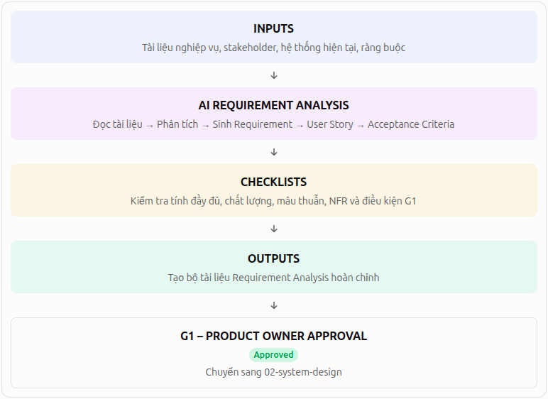

## 1. Kiến trúc

Giai đoạn Requirement Analysis tuân theo cấu trúc chung của framework:

| Thành phần | Vai trò |
|---|---|
| `README.md` | Mục tiêu, phạm vi và cấu trúc của giai đoạn |
| `workflow.md` | Các bước thực hiện |
| `ai-instructions.md` | Hướng dẫn AI thực hiện |
| `human-review.md` | Trách nhiệm review của con người |
| `inputs/` | **Inputs** – AI nhận được gì |
| `templates/` | **Templates** – AI nên cấu trúc công việc như thế nào |
| `checklists/` | **Checklists** – Chất lượng được kiểm tra như thế nào |
| `outputs/` | **Outputs** – AI phải bàn giao gì |

Ba folder `inputs/`, `checklists/` và `outputs/` được mô tả chi tiết ở mục 2; `templates/` là biểu mẫu chuẩn để AI trình bày các artifact trong `outputs/`.

## 2. Nội dung chi tiết từng folder

### 2.1. Folder `inputs/` – Tài liệu đầu vào

Mục đích: Cung cấp đầy đủ thông tin để AI hiểu bài toán nghiệp vụ trước khi phân tích và tạo Requirement.

| File | Nội dung |
|---|---|
| `README.md` | Hướng dẫn chuẩn bị tài liệu đầu vào |
| `input-document-register.md` | Danh sách và trạng thái tài liệu đầu vào |
| `business-context.md` | Bối cảnh, mục tiêu và vấn đề nghiệp vụ |
| `stakeholder-information.md` | Thông tin các bên liên quan |
| `existing-system-context.md` | Thông tin hệ thống hiện tại |
| `constraints-and-assumptions.md` | Ràng buộc và giả định ban đầu |

### 2.2. Folder `checklists/` – Danh sách kiểm tra

Mục đích: Đảm bảo AI không bỏ sót thông tin, không tạo yêu cầu thiếu căn cứ và không đưa một bộ Requirement chưa đạt chất lượng sang giai đoạn System Design.

| File | Nội dung |
|---|---|
| `README.md` | Hướng dẫn sử dụng bộ checklist |
| `01-input-completeness-checklist.md` | Kiểm tra tính đầy đủ của tài liệu đầu vào |
| `02-requirement-analysis-checklist.md` | Kiểm tra quá trình phân tích yêu cầu |
| `03-requirement-quality-checklist.md` | Kiểm tra chất lượng của yêu cầu |
| `04-ambiguity-and-conflict-checklist.md` | Kiểm tra mơ hồ và mâu thuẫn trong yêu cầu |
| `05-non-functional-requirement-checklist.md` | Kiểm tra yêu cầu phi chức năng |
| `06-G1-approval-checklist.md` | Kiểm tra điều kiện trước khi phê duyệt G1 |

### 2.3. Folder `outputs/` – Kết quả đầu ra

Mục đích: Lưu toàn bộ sản phẩm được tạo ra từ Requirement Analysis.

Tôi đề xuất chia thành 3 nhóm logic:

| Nhóm | File | Mục đích |
|---|---|---|
| Phân tích (Analysis) | `requirement-analysis-report.md` | Báo cáo tổng hợp phân tích |
| Yêu cầu nghiệp vụ (Business Requirements) | `business-requirements.md` | Yêu cầu nghiệp vụ |
| Yêu cầu chức năng (Functional Requirements) | `functional-requirements.md` | Yêu cầu chức năng |
| Yêu cầu phi chức năng (Non-Functional Requirements) | `non-functional-requirements.md` | Yêu cầu phi chức năng |
| User Story (User Stories) | `user-stories.md` | Danh sách User Story |
| Tiêu chí nghiệm thu (Acceptance Criteria) | `acceptance-criteria.md` | Tiêu chí nghiệm thu |
| Use Case (Use Cases) | `use-cases.md` | Các trường hợp sử dụng |
| Làm rõ (Clarification) | `open-questions.md` | Câu hỏi chưa được giải đáp |
| Làm rõ (Clarification) | `assumptions-and-constraints.md` | Giả định và ràng buộc đã xác định |
| Truy vết (Traceability) | `requirement-traceability-matrix.md` | Ma trận truy vết |
| Phê duyệt (Approval) | `G1-approval-record.md` | Hồ sơ phê duyệt G1 |

> **Lưu ý:** `outputs/G1-approval-record.md` không được AI tự điền quyết định phê duyệt. AI chỉ được chuẩn bị hồ sơ và trạng thái chờ review.

## 3. Quy trình sử dụng 3 folder trong thực tế

Ba folder `inputs/`, `checklists/` và `outputs/` không hoạt động độc lập mà liên kết theo một quy trình:

Nếu checklist không đạt:

- AI ghi nhận các mục FAIL.
- Xác định tài liệu hoặc yêu cầu cần điều chỉnh.
- Bổ sung câu hỏi vào `open-questions.md` nếu cần.
- Cập nhật `outputs/`.
- Chạy lại checklist.
- Gửi Product Owner review lại.
