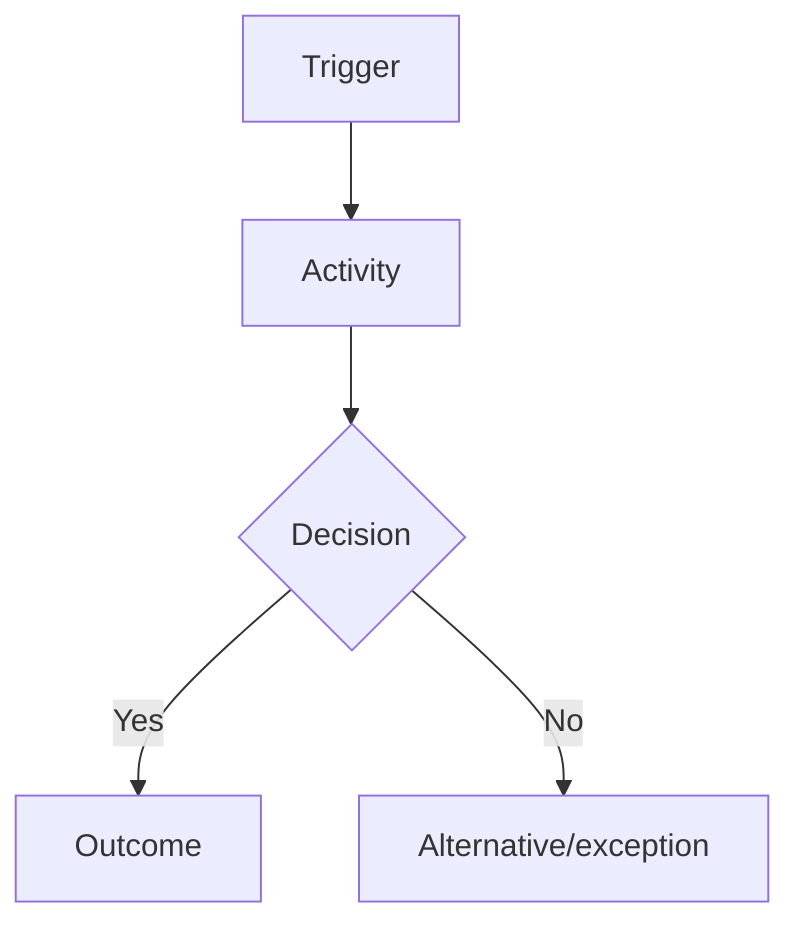

# Mô hình quy trình nghiệp vụ (Business Process Model)

> Đầu ra tùy chọn. Nếu không áp dụng cho dự án, ghi N/A và lý do trong G1 Approval package. Giữ cấu trúc/template này để project cần thì sử dụng.

## Thông tin tài liệu

| Trường | Giá trị |
|---|---|
| Mã tài liệu | BPM-0001 |
| Quy trình | |
| Phiên bản | 0.1 |
| Trạng thái | DRAFT |
| Process owner | |
| Nguồn/Scope/BRQ liên quan | |

## Mục tiêu và ranh giới

- Kết quả nghiệp vụ mong đợi:
- Trigger:
- Điều kiện kết thúc:
- Phạm vi quy trình:

## Actor và trách nhiệm

| Actor/Role | Trách nhiệm | Hệ thống/đơn vị |
|---|---|---|

## Sơ đồ

## Các bước và sự kiện

| Bước | Actor | Activity | Đầu vào | Decision/Event | Đầu ra | BR/FR/UC liên quan |
|---|---|---|---|---|---|---|

## Ngoại lệ/biến thể

| Điều kiện | Cách xử lý | Owner quyết định | Artifact liên quan |
|---|---|---|---|

## Lịch sử thay đổi

| Phiên bản | Ngày | Người cập nhật | Thay đổi |
|---|---|---|---|
