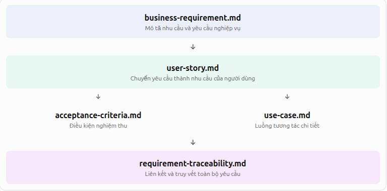

# Templates - 01 Requirement Analysis

## Giới thiệu

Bộ template được thiết kế để sử dụng xuyên suốt giai đoạn Requirement Analysis, hỗ trợ cả Business Analyst, Product Owner, AI Agent và đội ngũ phát triển.

## Quan hệ giữa 5 template



| Template | Vai trò |
|---|---|
| `business-requirement.md` | Mô tả nhu cầu và yêu cầu nghiệp vụ |
| `user-story.md` | Chuyển yêu cầu thành nhu cầu của người dùng |
| `acceptance-criteria.md` | Điều kiện nghiệm thu |
| `use-case.md` | Luồng tương tác chi tiết |
| `requirement-traceability.md` | Liên kết và truy vết toàn bộ yêu cầu |

## Nguyên tắc

- **Business Requirement** là nguồn gốc của yêu cầu.
- **User Story** mô tả yêu cầu từ góc nhìn người dùng.
- **Acceptance Criteria** xác định điều kiện đạt.
- **Use Case** mô tả tương tác và luồng xử lý.
- **Requirement Traceability** quản lý mối liên kết giữa các tài liệu và các giai đoạn SDLC.

Các ID phải được thống nhất để AI có thể tự động liên kết tài liệu, ví dụ: `BR-001`, `US-001`, `AC-001`, `UC-001`.

## Kiến trúc

```
templates/
├── README.md                          # Hướng dẫn sử dụng và quan hệ giữa các template
├── business-requirement.md            # Template yêu cầu nghiệp vụ (BR)
├── user-story.md                      # Template User Story (US)
├── acceptance-criteria.md             # Template tiêu chí nghiệm thu (AC)
├── use-case.md                        # Template Use Case (UC)
└── requirement-traceability.md        # Template ma trận truy vết (RTM)
```

Template là khuôn mẫu chưa có dữ liệu thật. Khi tạo artifact thực tế, nội dung được điền vào `../outputs/` theo đúng cấu trúc của template tương ứng.

## Vai trò từng file

| File | Vai trò | Được dùng để tạo | Thứ tự phụ thuộc |
|---|---|---|---|
| `README.md` | Mô tả bộ template, quan hệ giữa các template và nguyên tắc ID. | — | Đọc đầu tiên |
| `business-requirement.md` | Khuôn cho BR, mục tiêu nghiệp vụ, phạm vi, quy tắc, NFR, rủi ro và phê duyệt G1. | `outputs/business-requirements.md` | Gốc, tạo đầu tiên |
| `user-story.md` | Khuôn cho US: phát biểu As a / I want / So that, luồng, DoR và DoD. | `outputs/user-stories.md` | Sau BR |
| `acceptance-criteria.md` | Khuôn cho AC, kịch bản Given / When / Then, kiểm thử âm tính và trạng thái nghiệm thu. | `outputs/acceptance-criteria.md` | Sau US |
| `use-case.md` | Khuôn cho UC: actor, luồng chính, luồng thay thế, ngoại lệ và hậu điều kiện. | `outputs/use-cases.md` | Sau US, song song AC |
| `requirement-traceability.md` | Khuôn cho RTM: liên kết xuyên suốt BR → US → AC → UC → thiết kế → test, phân tích khoảng trống và tác động thay đổi. | `outputs/requirement-traceability-matrix.md` | Cuối cùng, tổng hợp các file trên |
