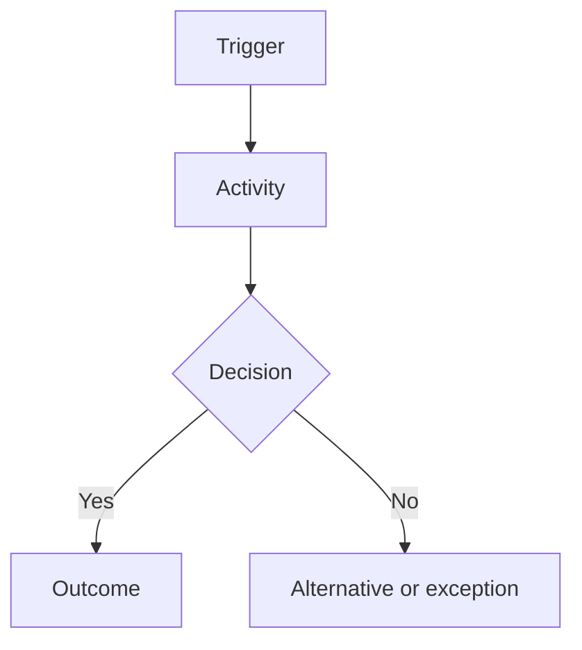

# Mô hình quy trình nghiệp vụ (Business Process Model)

> **Đầu ra tùy chọn.** Tạo khi quy trình nghiệp vụ, handoff hoặc quyết định giữa các vai trò cần được mô hình hóa để làm rõ yêu cầu. Nếu không áp dụng, ghi `N/A` cùng lý do trong danh mục đầu ra/review package.

## 1. Thông tin tài liệu

| Trường | Giá trị |
|---|---|
| Mã tài liệu | BPM-0001 |
| Dự án | [Tên dự án] |
| Quy trình | [Tên quy trình] |
| Phiên bản | 0.1 |
| Trạng thái | Draft |
| Process owner | [Owner] |
| Ngày cập nhật | [YYYY-MM-DD] |
| Scope/BRQ liên quan | [ID] |

## 2. Mục đích và ranh giới quy trình

- Mục tiêu/kết quả: [Mô tả]
- Sự kiện bắt đầu: [Trigger]
- Sự kiện kết thúc: [Điều kiện kết thúc]
- Phạm vi quy trình: [Điểm bắt đầu/kết thúc và các giới hạn]
- Giả định/phụ thuộc liên quan: [ID]

## 3. Actor và trách nhiệm

| Actor/Role | Trách nhiệm | Hệ thống/đơn vị liên quan |
|---|---|---|
| [Tên] | [Trách nhiệm] | [Tên] |

## 4. Luồng quy trình

Sơ đồ quy trình (Mermaid/BPMN hoặc liên kết):

Mô tả các bước:

| Bước | Actor | Hoạt động | Đầu vào | Quyết định/sự kiện | Đầu ra | BR/FR/UC liên quan |
|---|---|---|---|---|---|---|
| 1 | [Actor] | [Hoạt động] | [Dữ liệu] | [Điều kiện] | [Kết quả] | [IDs] |

## 5. Ngoại lệ và biến thể

| ID | Điều kiện | Hành vi/luồng xử lý | Owner quyết định | Yêu cầu liên quan |
|---|---|---|---|---|
| BPM-EX-001 | [Điều kiện] | [Xử lý] | [Owner] | [IDs] |

## 6. Quy tắc, yêu cầu và vấn đề mở

- Business Rules: [BR IDs]
- Functional/Non-functional Requirements: [FR/NFR IDs]
- Use Cases/Acceptance Criteria: [UC/AC IDs]
- Câu hỏi mở/phụ thuộc: [IDs]

## 7. Lịch sử và xác nhận

| Phiên bản | Ngày | Người cập nhật | Thay đổi | Xác nhận process owner |
|---|---|---|---|---|
| 0.1 | [YYYY-MM-DD] | [Owner] | Bản nháp ban đầu | [Pending/Approved] |
