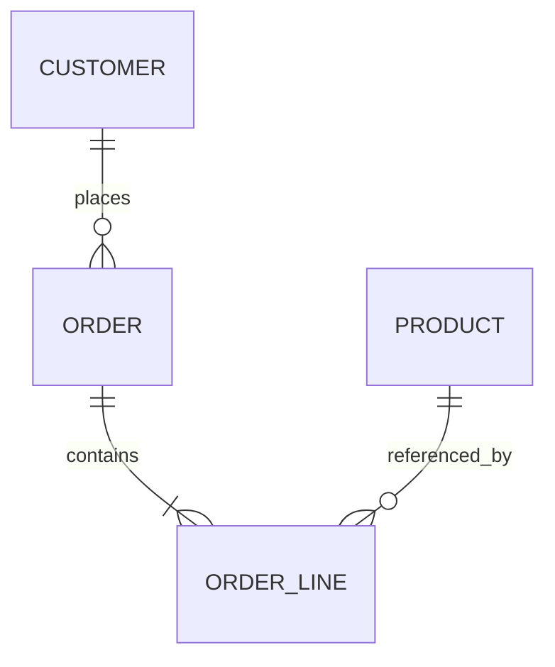

# Mẫu Mô hình Dữ liệu

## 1. Kiểm soát tài liệu
| Trường | Giá trị |
|---|---|
| Miền nghiệp vụ / bounded context | |
| ID / phiên bản mô hình | `DM-XXX / 0.1` |
| Trạng thái | `Draft / In Review / Approved` |
| Chủ sở hữu | |
| Requirement baseline | |

## 2. Tổng quan miền
- Năng lực nghiệp vụ:
- Ranh giới miền:
- Nguồn dữ liệu chuẩn (source of truth):
- Quyền sở hữu dữ liệu:
- Các khái niệm nghiệp vụ chính:

## 3. Mô hình khái niệm

**Liên kết sơ đồ:** `[URL/đường dẫn]`

## 4. Danh mục thực thể
| ID thực thể | Thực thể | Định nghĩa | Định danh | Chủ sở hữu / aggregate |
|---|---|---|---|---|

## 5. Từ điển dữ liệu
| Thực thể | Thuộc tính | Kiểu | Bắt buộc? | Giá trị / định dạng cho phép | Phân loại | Mô tả |
|---|---|---|---:|---|---|---|

## 6. Quan hệ & Cardinality
| Thực thể A | Quan hệ | Thực thể B | Cardinality | Quy tắc nghiệp vụ |
|---|---|---|---|---|

## 7. Bất biến nghiệp vụ & Vòng đời
- Bất biến:
- Chuyển trạng thái:
- Quyền tạo/cập nhật:
- Xóa mềm / xóa cứng:
- Lưu giữ / lưu trữ:
- Yêu cầu lịch sử / audit:

## 8. Luồng dữ liệu & Tích hợp
| Nguồn | Dữ liệu / sự kiện | Biến đổi | Đích | Quyền sở hữu / hợp đồng |
|---|---|---|---|---|

## 9. Quy tắc validation & chất lượng dữ liệu
| ID quy tắc | Thực thể / thuộc tính | Quy tắc | Xử lý lỗi |
|---|---|---|---|

## 10. Quyền riêng tư & Quản trị dữ liệu
- PII / dữ liệu nhạy cảm:
- Tối thiểu hóa dữ liệu:
- Che / ẩn danh:
- Chính sách truy cập:
- Lưu giữ và xóa:
- Data lineage:

## 11. Ánh xạ vật lý & Phê duyệt
| Thực thể / thuộc tính miền | Bảng / cột | Biến đổi | Ghi chú |
|---|---|---|---|

| ID Requirement | Thực thể / quy tắc | Kiểm chứng |
|---|---|---|

| Người review | Vai trò | Quyết định | Ngày |
|---|---|---|---|
| | Domain / Data Architect | | |
| | Tech Lead | | |
