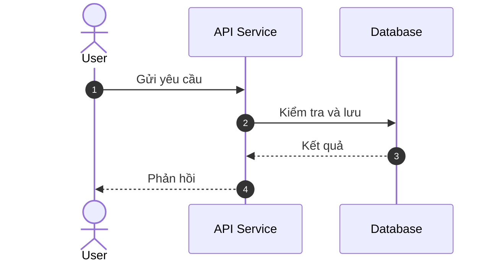

# Mẫu Biểu đồ Tuần tự

## 1. Kiểm soát tài liệu
| Trường | Giá trị |
|---|---|
| ID / Tên luồng | `FLOW-XXX / [Tên]` |
| Phiên bản / Trạng thái | `0.1 / Draft` |
| Tác giả / Chủ sở hữu | |
| Story / AC liên quan | |
| API / component liên quan | |

## 2. Mô tả luồng
- Mục tiêu nghiệp vụ:
- Trigger:
- Actor / hệ thống khởi tạo:
- Điều kiện tiên quyết:
- Kết quả thành công:
- Kết quả thất bại:
- Giả định:

## 3. Các bên tham gia
| Bên tham gia | Loại | Trách nhiệm |
|---|---|---|

## 4. Luồng thành công chính

## 5. Luồng thay thế & Luồng lỗi
| ID luồng | Điều kiện | Hành vi kỳ vọng | Phục hồi / bù trừ |
|---|---|---|---|
| ALT-01 | Validation thất bại | | |
| ALT-02 | Dependency timeout | | |
| ALT-03 | Yêu cầu bị trùng lặp | | |

## 6. Hành vi xuyên suốt
- Xác thực / phân quyền: bước nào kiểm tra quyền gì; quy tắc theo `SEC-DES-XXX §…`.
- Validation:
- Transaction / nhất quán:
- Idempotency:
- Timeout / retry:
- Nhất quán cuối cùng (eventual consistency):
- Log / correlation ID:
- Xử lý dữ liệu nhạy cảm:

## 7. Hợp đồng & Truy vết
| Bước / tương tác | Hợp đồng API / sự kiện | Requirement / AC | Trường hợp lỗi |
|---|---|---|---|

## 8. Review
- [ ] Luồng chính đã đầy đủ.
- [ ] Luồng thay thế và luồng lỗi đã được thể hiện.
- [ ] Đã xét timeout, retry và yêu cầu trùng lặp.
- [ ] Ranh giới phân quyền và dữ liệu rõ ràng.
- [ ] Biểu đồ khớp với thiết kế API và component.

| Người review | Vai trò | Quyết định | Ngày |
|---|---|---|---|
| | Architect / Tech Lead | | |
