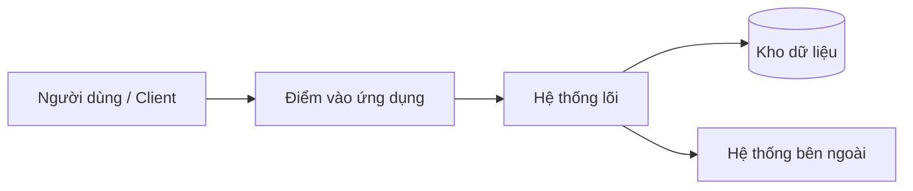

# Mẫu Kiến trúc Hệ thống

## 1. Kiểm soát tài liệu
| Trường | Giá trị |
|---|---|
| Dự án / Hệ thống | |
| ID kiến trúc | `ARCH-XXX` |
| Phiên bản / Trạng thái | `0.1 / Draft` |
| Kiến trúc sư / Chủ sở hữu | |
| Requirement baseline | |
| Ngày | |

## 2. Bối cảnh, Mục tiêu & Phạm vi
- Bối cảnh nghiệp vụ:
- Mục tiêu thiết kế:
- Trong phạm vi / ngoài phạm vi:
- Các bên liên quan và mối quan tâm:
- Giả định / ràng buộc / phụ thuộc:

## 3. Động lực từ thuộc tính chất lượng
| Thuộc tính | Yêu cầu / mục tiêu | Ưu tiên | Cách kiểm chứng |
|---|---|---|---|
| Tính sẵn sàng (Availability) | | | |
| Hiệu năng / độ trễ (Performance / latency) | | | |
| Khả năng mở rộng (Scalability) | | | |
| Bảo mật / quyền riêng tư (Security / privacy) | | | |
| Khả năng bảo trì (Maintainability) | | | |
| Khả năng phục hồi (Recoverability) | | | |

## 4. Tổng quan kiến trúc
- Kiểu kiến trúc và lý do:
- Nguyên tắc chính:
- Liên kết sơ đồ bối cảnh:
- Liên kết sơ đồ container/component:

## 5. Component & Trách nhiệm
| ID component | Component | Trách nhiệm | Giao diện | Quyền sở hữu dữ liệu | Chủ sở hữu |
|---|---|---|---|---|---|
| CMP-01 | | | | | |

## 6. Góc nhìn triển khai / runtime
- Topology runtime:
- Môi trường:
- Mạng / ranh giới tin cậy:
- Tính toán, mở rộng, availability zone:
- Liên kết sơ đồ hạ tầng:

## 7. Tích hợp & Giao tiếp
| Nguồn | Đích | Giao thức / cơ chế | Đồng bộ/Bất đồng bộ | Tham chiếu hợp đồng | Xử lý lỗi |
|---|---|---|---|---|---|

## 8. Thiết kế xuyên suốt
- Xác thực / phân quyền:
- Logging, metric, tracing:
- Xử lý lỗi:
- Cấu hình và secret:
- Cache / messaging:
- Timeout, retry, circuit breaker:
- Lưu giữ dữ liệu và quyền riêng tư:

## 9. Công nghệ sử dụng
| Lớp | Công nghệ & phiên bản được chọn | Phương án thay thế | Lý do | Ràng buộc |
|---|---|---|---|---|
| Frontend | | | | |
| Backend | | | | |
| Database | | | | |
| Messaging / cache | | | | |
| Hạ tầng | | | | |

## 10. Rủi ro & Đánh đổi
| ID | Rủi ro / đánh đổi | Tác động | Giải pháp giảm thiểu | Người phụ trách |
|---|---|---|---|---|

## 11. Artifact liên quan
| Artifact | ID / phiên bản | Vị trí | Trạng thái |
|---|---|---|---|
| ADR | | | |
| Đặc tả API | | | |
| Thiết kế CSDL | | | |
| Mô hình dữ liệu | | | |
| Biểu đồ tuần tự | | | |
| Thiết kế bảo mật | | | |

## 12. Truy vết & Phê duyệt
| ID Requirement / NFR | Phần tử kiến trúc | Bằng chứng |
|---|---|---|

| Người review | Vai trò | Quyết định | Điều kiện | Ngày |
|---|---|---|---|---|
| | Solution Architect | `Phê duyệt / Yêu cầu chỉnh sửa` | | |
| | Tech Lead | | | |
| | Chủ sở hữu bảo mật / dữ liệu (nếu cần) | | | |

**Trạng thái cuối:** `Draft / In Review / Approved / Superseded`  
**Tham chiếu phê duyệt G2:** `[Link]`
