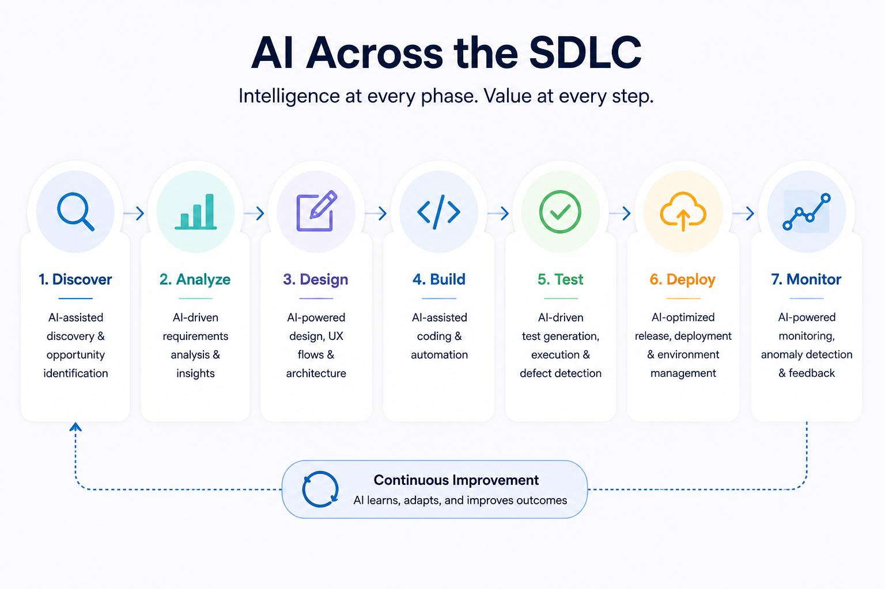
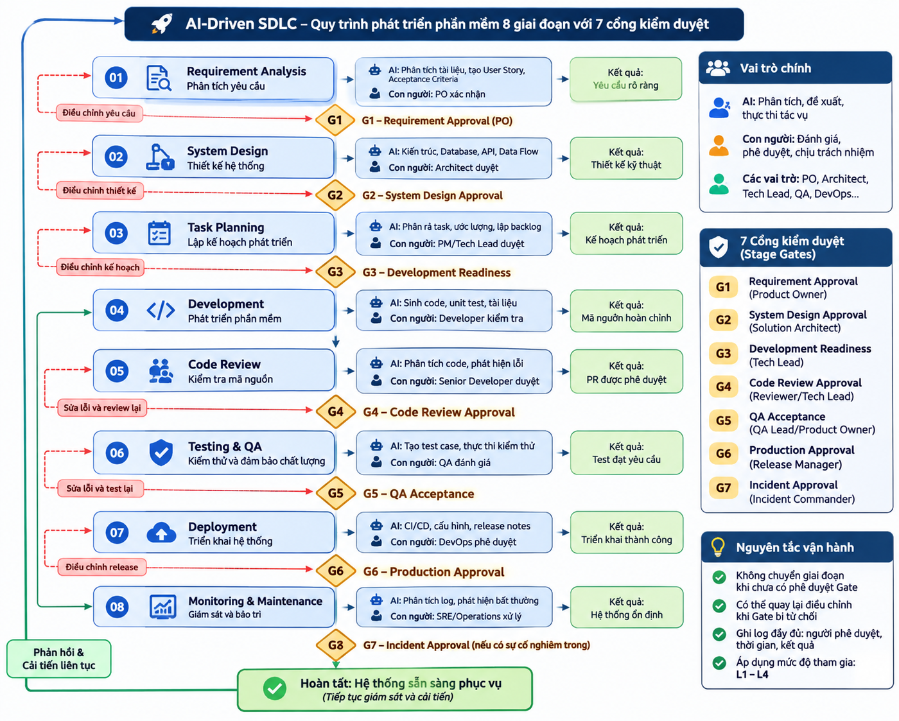

# Framework AI-Driven SDLC

## Mục tiêu

Xây dựng quy trình phát triển phần mềm trong đó AI tham gia tất cả các giai đoạn, từ phân tích yêu cầu, thiết kế, lập trình, kiểm thử, triển khai đến vận hành, đồng thời quy định rõ trách nhiệm và điểm kiểm soát của con người (Human-in-the-Loop).

> **Ánh xạ từ ảnh sang quy trình 8 giai đoạn:**
> - 1. Requirement Analysis (Phân tích yêu cầu) gộp từ *1. Discover* và *2. Analyze*.
> - 2. System Design và 3. Task Planning tách từ *3. Design*.
> - 4. Development và 5. Code Review tách từ *4. Build*.
> - 6. Testing & QA và 7. Deployment giữ nguyên tên *5. Test* và *6. Deploy*.
> - 8. Monitoring & Maintenance gộp từ *7. Monitor* và *Continuous Improvement*.

## Nguyên tắc

- **AI thực hiện:** phân tích, đề xuất, tạo mã nguồn, sinh tài liệu, kiểm thử, phát hiện lỗi và đề xuất khắc phục.
- **Con người review:** xác nhận tính đúng đắn, nghiệp vụ, kiến trúc, bảo mật và chất lượng.
- **Không để AI tự quyết định vấn đề rủi ro cao:** phê duyệt yêu cầu, thay đổi kiến trúc, phát hành production, thay đổi dữ liệu quan trọng và xử lý sự cố nghiêm trọng phải có người chịu trách nhiệm.

## Cách dùng AI cho mọi vai trò

Mọi vai trò dùng AI theo cùng một luồng `Role → Stage → Task → Context → Execute → Review → Output`. Quy tắc đầy đủ nằm tại [ai-usage-flow.md](../shared-ai/rules/core/ai-usage-flow.md).

## Bắt đầu theo vai trò

Mỗi vai trò có thể làm việc, xác nhận nội dung hoặc duyệt gate. Ba việc này không luôn thuộc cùng một người. Chi tiết trách nhiệm nằm ở `human-review.md` của từng giai đoạn và [gate-policy](governance/human-review-gates/gate-policy.md).

| Vai trò | Giai đoạn tham gia | Việc chính | Gate |
|---|---|---|---|
| Product Owner (PO) | 01, 03, 06, 07 | Chốt phạm vi và ưu tiên, duyệt yêu cầu, nghiệm thu nghiệp vụ | Duyệt G1; cùng QA Lead duyệt G5 |
| Business Analyst (BA) | 01, 02 | Điều phối phân tích, soạn yêu cầu, quản lý baseline và truy vết | Trình G1 |
| Stakeholder / SME | 01, 02 | Xác nhận quy tắc và ngoại lệ nghiệp vụ | Không |
| Solution Architect | 02 | Thiết kế kiến trúc, quyết định kỹ thuật | Duyệt G2 |
| Tech Lead | 02, 03, 04, 05 | Rà soát thiết kế, duyệt kế hoạch task, kiểm soát lệch thiết kế, duyệt merge | Duyệt G3; là một trong các vai được duyệt G4 |
| Project Manager (PM) | 03 | Kế hoạch, tiến độ, nguồn lực, rủi ro | Review G3 |
| Developer | 03, 04, 05 | Nhận task đã duyệt, thực hiện, bàn giao PR | Không (04 chỉ kiểm tra bàn giao) |
| Reviewer / Senior Developer | 05 | Review code, xử lý finding | Duyệt G4 (một trong Reviewer, Senior Developer, Tech Lead) |
| Security / Data owner | 02, 04, 05, 07 | Review phần bảo mật và dữ liệu khi áp dụng | Không |
| QA Lead / QA Engineer | 03, 06, 07 | Chiến lược và thực thi kiểm thử, sign-off chất lượng | QA Lead duyệt G5 (cùng PO) |
| DevOps / Release Manager | 07 | Pipeline, môi trường, rollback, phát hành | Release Manager duyệt G6 |
| SRE / Operations | 08 | Giám sát, cảnh báo, runbook | Không (monitoring thường kỳ không chặn) |
| Incident Commander | 08 | Điều phối sự cố nghiêm trọng | Duyệt G7 (chỉ khi có sự cố nghiêm trọng) |

AI hỗ trợ ở mọi vai trò nhưng không phê duyệt. Xem [cách dùng AI](../shared-ai/rules/core/ai-usage-flow.md).

## Chuẩn hóa cấu trúc bên trong mỗi giai đoạn

Để framework không bị rời rạc, cả 8 giai đoạn tuân theo cùng một cấu trúc:

| Thành phần | Vị trí | Vai trò |
|---|---|---|
| `README.md` | Framework | Mục tiêu và phạm vi giai đoạn |
| `workflow.md` | Framework | Các bước thực hiện |
| `ai-instructions.md` | Framework | Hướng dẫn AI thực hiện |
| `human-review.md` | Framework | Trách nhiệm review của con người |
| `inputs/` | Framework và/hoặc project | Quy định, tiếp nhận đầu vào từ giai đoạn trước |
| `templates/` | Framework | Mẫu tài liệu chuẩn dùng chung |
| `checklists/` | Framework | Tiêu chí kiểm tra chất lượng |
| `outputs/` | Framework | Hướng dẫn và quy định cấu trúc đầu ra |
| `outputs/` | Project instance | Tài liệu thực tế của dự án |

Vai trò của từng thư mục con trong giai đoạn:

- **Inputs** = AI nhận được gì: tài liệu đầu vào mà AI dùng để thực hiện công việc.
- **Templates** = AI nên cấu trúc công việc như thế nào: biểu mẫu chuẩn để AI trình bày kết quả trung gian và cuối cùng.
- **Checklists** = Chất lượng được kiểm tra như thế nào: danh sách tiêu chí để AI tự kiểm tra và để con người đối chiếu khi review.
- **Outputs** = AI phải bàn giao gì: kết quả đầu ra bắt buộc của giai đoạn, làm đầu vào cho giai đoạn tiếp theo hoặc cho Gate tương ứng.

## Quy trình 8 giai đoạn

### 1. Requirement Analysis – Phân tích yêu cầu
- **AI:** phân tích tài liệu nghiệp vụ, làm rõ yêu cầu, xác định phạm vi và chức năng; tạo User Story, Acceptance Criteria; xác định yêu cầu thiếu hoặc chưa rõ.
- **Con người:** Product Owner xác nhận yêu cầu nghiệp vụ, User Story, phạm vi và tiêu chí nghiệm thu.

### 2. System Design – Thiết kế hệ thống
- **AI:** đề xuất kiến trúc tổng thể, thiết kế Database, API, luồng xử lý, mô hình dữ liệu và giải pháp kỹ thuật phù hợp.
- **Con người:** Architect/Tech Lead đánh giá, điều chỉnh, phê duyệt kiến trúc, thiết kế kỹ thuật và các quyết định công nghệ quan trọng.

### 3. Task Planning – Lập kế hoạch phát triển
- **AI:** phân rã yêu cầu thành công việc cụ thể, ước lượng effort, xác định phụ thuộc, đề xuất thứ tự thực hiện, xây dựng backlog.
- **Con người:** PM/Tech Lead phê duyệt kế hoạch, mức ưu tiên, thời gian và phân bổ nguồn lực.

### 4. Development – Phát triển phần mềm
- **AI:** sinh code theo thiết kế và yêu cầu đã thống nhất, hoàn thiện chức năng, refactor, tạo unit test, cập nhật tài liệu kỹ thuật.
- **Con người:** Developer kiểm tra logic nghiệp vụ, tính chính xác, hiệu năng, khả năng bảo trì và mức tuân thủ thiết kế.

### 5. Code Review – Kiểm tra mã nguồn
- **AI:** phân tích mã nguồn, phát hiện lỗi logic, bug tiềm ẩn, lỗ hổng bảo mật, vấn đề hiệu năng, vi phạm coding convention; đề xuất hướng khắc phục.
- **Con người:** Senior Developer/Tech Lead đánh giá kết quả, xác nhận chất lượng, phê duyệt Pull Request và chịu trách nhiệm quyết định merge.

### 6. Testing & QA – Kiểm thử và đảm bảo chất lượng
- **AI:** sinh test case theo yêu cầu và Acceptance Criteria, thực thi các loại kiểm thử phù hợp, phân tích kết quả, phát hiện lỗi, đề xuất khắc phục.
- **Con người:** QA đánh giá Test Coverage, xác nhận kết quả, kiểm tra lỗi tồn tại và quyết định mức đáp ứng tiêu chí nghiệm thu.

### 7. Deployment – Triển khai hệ thống
- **AI:** xây dựng và tối ưu CI/CD Pipeline, chuẩn bị cấu hình môi trường, tự động hóa triển khai, tạo Release Note, đề xuất phương án rollback.
- **Con người:** DevOps/Release Manager kiểm tra cấu hình, đánh giá rủi ro, xác nhận kế hoạch rollback và phê duyệt trước khi lên Production.

### 8. Monitoring & Maintenance – Giám sát và bảo trì
- **AI:** phân tích log, metrics, dữ liệu vận hành; phát hiện bất thường, cảnh báo, hỗ trợ Root Cause Analysis, đề xuất xử lý, tối ưu hoặc sửa lỗi.
- **Con người:** SRE/Operations đánh giá cảnh báo, xác nhận phương án, phê duyệt thay đổi hệ thống và trực tiếp kiểm soát sự cố nghiêm trọng.

### Quy trình luân chuyển dữ liệu giữa các giai đoạn

Sơ đồ dưới đây minh họa dữ liệu đi từ giai đoạn này sang giai đoạn kế tiếp, và các Human Approval Gate (G3, G4) nằm ở đâu. Hiện ảnh là giai đoạn 04 – Development.

