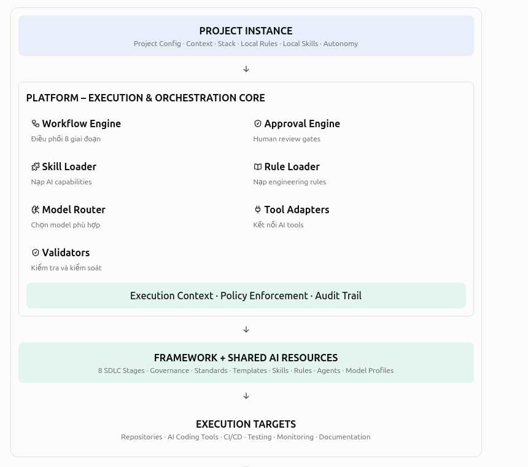

# Platform – Execution & Orchestration Core

## Kiến trúc platform đề xuất

Platform là lớp thực thi và orchestration trung tâm của mô hình AI-Driven SDLC. Platform nhận `Project Instance`, nạp các tài nguyên và policy phù hợp, sau đó điều phối workflow qua các human approval gate và ghi lại toàn bộ audit trail.



### Các lớp chính

#### Project Instance

Cấu hình và context riêng của từng project, bao gồm:

- Project config.
- Project context.
- Stack và local rules.
- Local skills.
- Autonomy policy.

#### Platform – Execution & Orchestration Core

- **Workflow Engine:** điều phối 8 giai đoạn của SDLC theo workflow đã định nghĩa.
- **Approval Engine:** thực thi Human Review Gates và kiểm soát điều kiện chuyển giai đoạn.
- **Skill Loader:** nạp các AI capabilities phù hợp với task và stage.
- **Rule Loader:** nạp engineering rules, project rules và policy liên quan.
- **Model Router:** chọn model phù hợp dựa trên task, độ phức tạp, policy và yêu cầu chất lượng.
- **Tool Adapters:** kết nối với các AI tools, repository, CI/CD, testing, monitoring và documentation systems.
- **Validators:** kiểm tra tính hợp lệ, tính đầy đủ, traceability và policy compliance của input/output.
- **Execution Context · Policy Enforcement · Audit Trail:** duy trì context trong quá trình thực thi, áp dụng policy và ghi lại bằng chứng/audit trail.

#### Framework + Shared AI Resources

- 8 SDLC Stages.
- Governance và Human Approval Gates.
- Standards.
- Templates.
- Skills.
- Rules.
- Agents.
- Model Profiles.

#### Execution Targets

Platform có thể thực thi tới các target sau:

- Repositories.
- AI Coding Tools.
- CI/CD.
- Testing.
- Monitoring.
- Documentation.

## Luồng xử lý chuẩn

```text
Project Context
  → Load Rules & Skills
  → Select Model
  → Execute Workflow
  → Validate
  → Approval Gate
  → Continue
  → Audit
```

### Nguyên tắc vận hành

1. `Project Context` được xác định trước khi bắt đầu execution.
2. `Rules & Skills` được load theo project, stage và task hiện tại.
3. `Model Router` chọn model đáp ứng yêu cầu về capability, quality, latency, cost và autonomy policy.
4. `Workflow Engine` thực thi các bước và tạo ra artifact/evidence cần thiết.
5. `Validators` kiểm tra output trước khi cho phép chuyển tiếp.
6. `Approval Engine` dừng tại các Human Approval Gate bắt buộc.
7. Chỉ sau khi gate được approve, workflow mới được `Continue` sang bước hoặc stage tiếp theo.
8. Mọi execution, validation, decision và approval phải được ghi vào `Audit Trail`.

## Cấu trúc thư mục

```text
platform/
├── README.md
│
├── tool-adapters/
├── skill-loader/
├── rule-loader/
├── model-router/
├── workflow-engine/
├── approval-engine/
├── validators/
│
└── scripts/
    ├── init-project.py
    ├── validate-project.py
    └── sync-framework.py
```

Chi tiết về các script xem tại [scripts/README.md](scripts/README.md).

## Tài liệu liên quan

- [Framework README](../framework/README.md)
- [Platform architecture](docs/architecture.md)
- [Shared AI resources](../shared-ai/)
